<!--
  ~ Licensed to the Apache Software Foundation (ASF) under one or more
  ~ contributor license agreements.  See the NOTICE file distributed with
  ~ this work for additional information regarding copyright ownership.
  ~ The ASF licenses this file to You under the Apache License, Version 2.0
  ~ (the "License"); you may not use this file except in compliance with
  ~ the License.  You may obtain a copy of the License at
  ~
  ~    http://www.apache.org/licenses/LICENSE-2.0
  ~
  ~ Unless required by applicable law or agreed to in writing, software
  ~ distributed under the License is distributed on an "AS IS" BASIS,
  ~ WITHOUT WARRANTIES OR CONDITIONS OF ANY KIND, either express or implied.
  ~ See the License for the specific language governing permissions and
  ~ limitations under the License.
  ~
  -->

# ZhoudaDataCheck

[](LICENSE)
[](https://openjdk.org/)
[](https://spring.io/projects/spring-boot)

ZhoudaDataCheck 是一套面向数据集成与处理过程的数据质量管理平台。它把数据源管理、元数据目录、数据画像、指标校验、质量作业、运行记录和表级血缘集中在一个 Web 控制台中，帮助团队发现空值、重复值、数值越界和行数异常等数据问题。

后端采用 Java 8、Spring Boot 2.7.18、Jetty、MyBatis-Plus、Quartz 和 HikariCP，前端采用 React、TypeScript 和 Ant Design。以下截图展示各功能页面及示例数据的实际效果，数据源名称和库表名称仅用于演示。

## 目录

- [核心功能清单](#核心功能清单)
- [功能总览](#功能总览)
- [数据源与连接管理](#数据源与连接管理)
- [数据目录与元数据](#数据目录与元数据)
- [数据画像](#数据画像)
- [质量分析与指标校验](#质量分析与指标校验)
- [血缘关系](#血缘关系)
- [质量作业与运行历史](#质量作业与运行历史)
- [执行引擎](#执行引擎)
- [架构与模块](#架构与模块)
- [快速开始](#快速开始)
- [构建与开发](#构建与开发)
- [作者](#作者)
- [贡献与许可](#贡献与许可)

## 核心功能清单

以下按功能域列出平台能力。未特别标注的能力可在 Web 页面使用；标注“API”或“后端”的能力目前主要通过接口或部署配置使用。

### 账户、工作空间与协作

- 用户登录、注册、图形验证码、密码重置。
- 工作空间创建、编辑、删除和切换。
- 工作空间成员邀请、成员分页查询、移除成员（API）。
- 租户与环境的创建、编辑、删除及选项查询（API）。
- 访问令牌创建、编辑、删除和分页管理。
- 中英文界面切换。

### 数据源与连接器

- 数据源新增、编辑、删除、分页查询和按工作空间筛选。
- 数据源连接测试、连接器类型查询和动态连接参数配置。
- 数据库、表、字段浏览与详情查询。
- 数据源 SQL 执行接口（API）。
- 默认前端可见的连接器类型包括 MySQL、PostgreSQL、Oracle、SQL Server、Dameng、Hive、Impala、Doris、StarRocks、ClickHouse、Trino、Presto、Databend、MaxCompute、MongoDB。
- 连接器通过插件扩展，实际可用类型取决于发布包中的插件、JDBC 驱动和目标环境。

### 元数据目录与标签

- 手动或定时执行元数据采集，查看采集任务记录。
- 按数据源、数据库、表、字段组织目录。
- 目录搜索、分页、数据库/表/字段详情查看。
- Schema Change 元数据变更记录与分页查询。
- 标签分类、标签的新建和删除。
- 实体与标签的关联、解除关联及按实体查询。
- 表级指标配置、指标看板与实体 Issue 查询、状态更新。
- 标签管理页面已实现，但默认不从主菜单显示。

### 数据画像

- 对整表或选定字段执行画像。
- 配置画像过滤条件。
- 手动执行、定时画像、画像执行历史。
- 表行数趋势与字段分布查看。
- Top 10 值分布。
- 空值数、空值率、非空数、非空率。
- 唯一数、唯一率、不同值数、不同值率。
- 最大值、最小值、总和、均值、标准差、方差。
- 最小长度、最大长度、平均长度、空字符串数。

### 质量校验与数据对账

- 四类校验规则：单表指标、单表自定义 SQL、多表准确性、多表值比较。
- 数据质量作业与数据对账作业。
- 库、表、字段选择与过滤条件配置。
- 固定值、表行数、目标表行数、日均值、周均值、月均值、近 7 天均值、近 30 天均值及空期望值。
- 实际值、差值、实际值减期望值、差值百分比等结果公式。
- 比较运算符、阈值、校验方向与通过/失败结果。
- 一条作业中组合多条规则。

#### 内置指标插件（28）

| 类别 | 指标 |
| --- | --- |
| 表级 | `table_row_count`、`freshness` |
| 空值与空字符串 | `column_null`、`column_not_null`、`column_blank` |
| 唯一性与分布 | `column_unique`、`column_duplicate`、`column_distinct`、`column_histogram` |
| 数值统计 | `column_avg`、`column_min`、`column_max`、`column_sum`、`column_std_dev`、`column_variance` |
| 长度统计 | `column_length`、`column_min_length`、`column_max_length`、`column_avg_length` |
| 枚举与正则 | `column_in_enums`、`column_not_in_enums`、`column_match_regex`、`column_match_not_regex` |
| 值域 | `column_value_between` |
| 自定义 SQL | `custom_count_sql`、`custom_aggregate_sql` |
| 多表校验 | `multi_table_accuracy`、`multi_table_value_comparison` |

### 作业管理与调度

- 作业新增、编辑、删除、详情查询和分页搜索。
- 按作业名、数据库、表、字段、更新时间等条件筛选。
- 保存、保存并运行、立即执行、预览和停止执行。
- 周期调度：每月、每周、每天、每小时、每隔 N 小时、每隔 N 分钟。
- 自定义 Cron、未来执行时间预览、生效开始时间和结束时间。
- 作业配置 JSON 查看、复制和下载。
- 作业关联 SLA。
- 作业参数中提供重试次数、重试间隔、超时时间和超时策略配置项；作业级超时与重试的执行层支持尚不完整。

### 执行引擎

- `local`：JDBC 本地执行。
- `spark`：Spark 执行扩展。
- `flink`：Flink 执行扩展。
- `livy`：通过 Livy 提交远程 Spark 作业。
- 引擎参数配置与执行插件扩展。
- Spark、Flink、Livy 需要对应的外部运行时和部署配置。

### 运行记录、结果与错误数据

- 运行历史分页、搜索和任务状态查看。
- 任务开始时间、结束时间和指标信息查看。
- 运行中任务停止。
- 日志增量查看、刷新和下载。
- 校验结果与实际值、期望值、阈值查看。
- 错误数据分页查看。
- 执行状态汇总、执行趋势图和质量统计。
- 质量分、质量分趋势与质量报告明细。
- 错误数据存储新增、编辑、删除、连接测试和分页查询（API/后端）。

### SLA 与告警

- SLA 创建、编辑、删除、查询及作业关联。
- 通知发送器与通知规则的创建、编辑、删除和查询。
- 通知配置参数查询和通知发送测试。
- 邮件、钉钉、飞书、企业微信通知插件。
- 规则校验失败通知已接入；执行失败通知尚未完整实现。
- 邮件或 Webhook 通知需要配置对应的 SMTP 或机器人地址。

### 数据血缘

- 人工新增、查询和删除表级血缘。
- 关系图展示数据流向。
- 按数据源全限定名或实体 UUID 查询血缘。
- 通过 SQL 解析生成血缘（API）。

### 开放接口与外部集成

- 访问令牌保护的 Open API。
- 外部触发作业执行、停止任务、查询执行状态和结果。
- 外部提交数据质量作业和数据对账作业（API）。
- 生成作业配置并通过提交脚本运行。
- 提供 Java HTTP Client 模块。

### 插件、注册与部署

- SPI 扩展：连接器、质量指标、期望值、结果公式、执行引擎、注册中心、错误数据存储、通知渠道。
- MySQL、PostgreSQL、ZooKeeper 注册中心插件。
- Quartz JDBC JobStore 与集群调度配置。
- Server 多实例注册、任务故障转移和跨节点日志访问。
- 发布包、启动/停止/状态脚本及 JMX 启动模式。
- Dockerfile、Docker Compose 和 Kubernetes 部署清单。
- Spring Boot Actuator 与 JMX/Prometheus 指标采集配置。

### 能力边界

- 当前没有完整的角色权限与菜单授权体系，成员管理不等同于 RBAC。
- 外部执行引擎、通知和错误数据存储需要单独准备运行环境与连接配置。
- Kubernetes 示例清单为单副本，生产高可用需要结合实际部署方案验证。
- CLI 模块和部分外部提交链路仍在完善，开放能力以当前 API 与发布包脚本为准。

## 功能总览

控制台提供 Overview、Quality Jobs、Run History、Connections、Alerts、Error Data 和 Members 等模块。Overview 按数据源展示质量分、质量趋势和执行概览，可以从同一入口进入质量作业和运行历史。

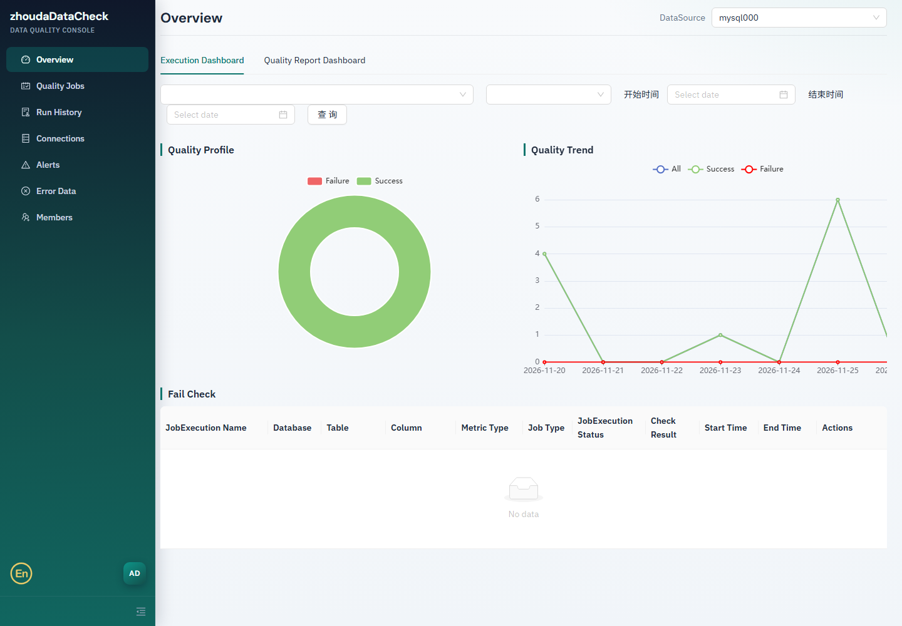

- 按数据源切换质量视图。
- 汇总质量分与质量趋势，快速了解数据质量变化。
- 通过质量作业执行规则，通过运行历史追踪每次任务。
- 数据源、任务、结果和血缘共享同一套目录上下文。

## 数据源与连接管理

Connections 页面以卡片方式管理数据源。平台通过连接器访问业务数据库，元数据采集和质量任务都依赖已配置的数据源。

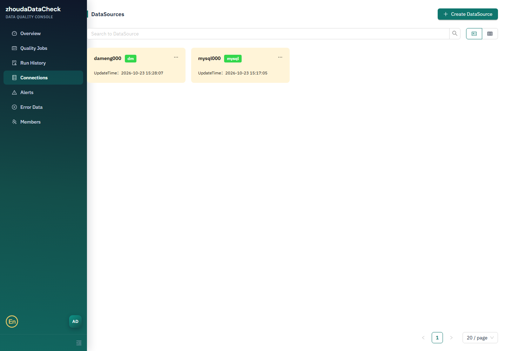

仓库中的连接器覆盖 MySQL、PostgreSQL、Dameng、Oracle、SQL Server、ClickHouse、Presto、Trino 等数据库，以及 Hive、Impala、StarRocks、Doris 等数据源。具体可用范围取决于对应连接器、JDBC 驱动和目标环境配置。

## 数据目录与元数据

数据目录按照“数据源 → 数据库 → 表 → 字段”组织元数据。数据源支持手动或定时采集，采集结果可供数据画像、指标配置和血缘页面共同使用。

- 浏览数据库、表和字段。
- 执行元数据刷新并记录元数据变化。
- 通过标签补充业务分类信息。
- 在目录中直接进入表的画像和指标页面。

## 数据画像

Data Profile 面向单张表计算行数、空值数、空值率、去重计数和不同值数量等统计信息，用于在制定质量规则前了解数据分布。

下图为示例客户表 `customers` 的画像结果：共 1,200 行，`age` 有 41 个空值，空值率约 3.42%，非空计数为 1,159；`city`、`gender`、`segment` 等字段的不同值数量也一并展示。

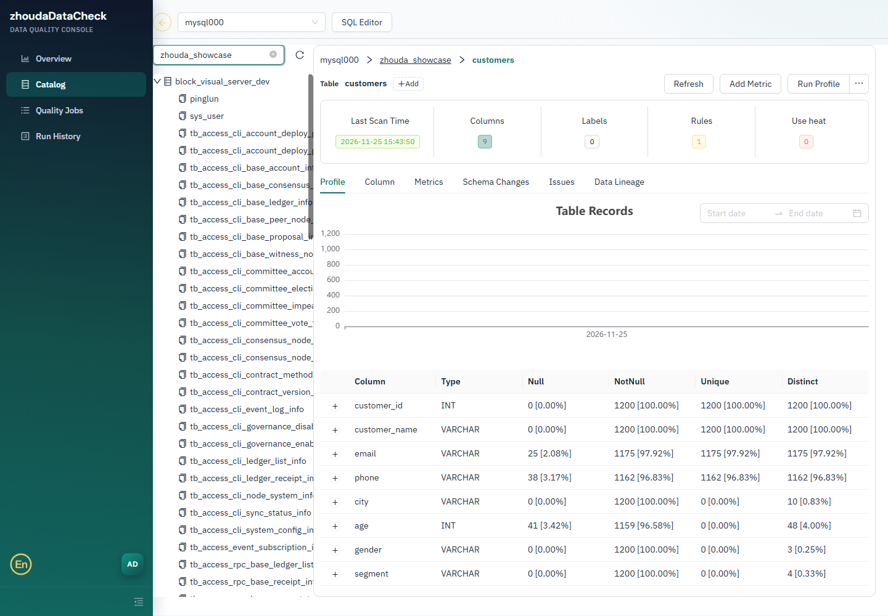

画像任务完成后，可以在页面查看表级统计和字段级统计，也可以结合 Run History 追踪执行状态。

## 质量分析与指标校验

质量作业把指标、数据范围、过滤条件、期望值、比较方式和阈值组合成可执行规则。作业配置提供重试次数、重试间隔、超时时间和超时策略参数项；其中作业级超时与重试的执行层支持尚不完整。

### 通过校验的结果

下图为订单完整性检查：`orders` 表行数为 5,000，`order_id` 的非空计数和唯一计数均为 5,000，三项规则全部通过。

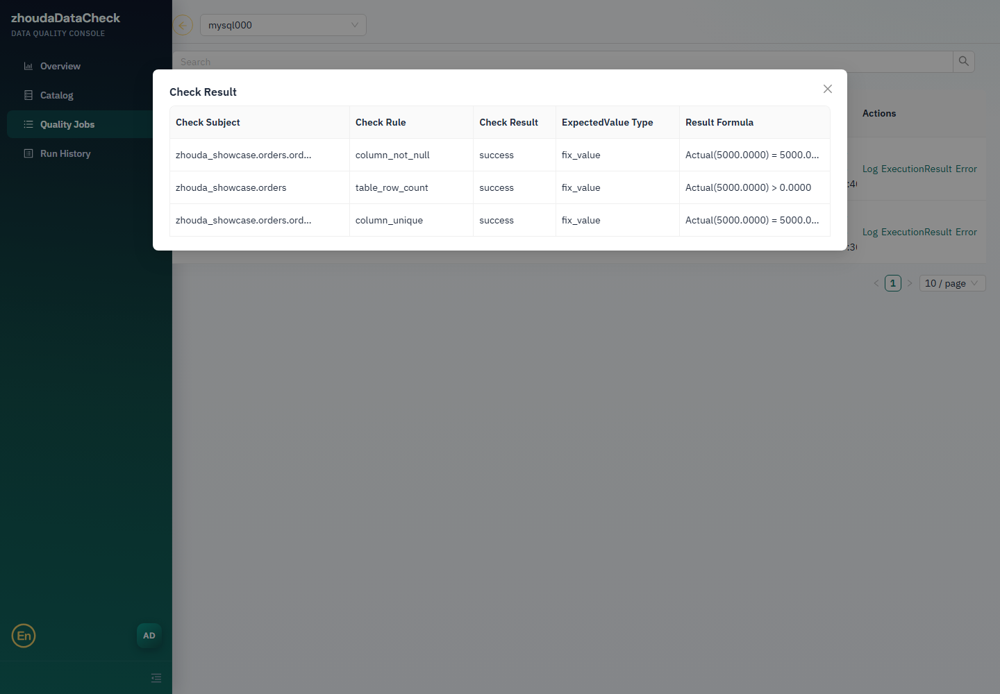

### 发现异常的结果

下图为客户与金额异常检查：`customers.age` 要求非空计数等于 1,200，实际为 1,159；`orders.amount` 要求落在 `0` 到 `100000` 范围内的行数等于 5,000，实际为 4,991。页面直接标出失败规则及实际值，便于进一步定位问题数据。

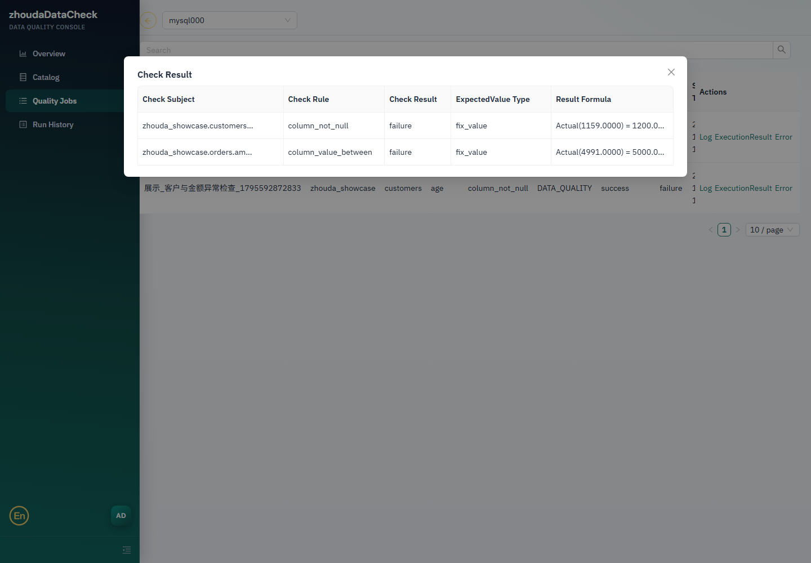

> 指标结果的含义以指标定义为准。例如 `column_not_null` 返回非空行数，`column_unique` 返回唯一计数，`column_value_between` 返回满足范围条件的行数；配置期望值时应使用对应的实际值语义。

### 指标与校验配置

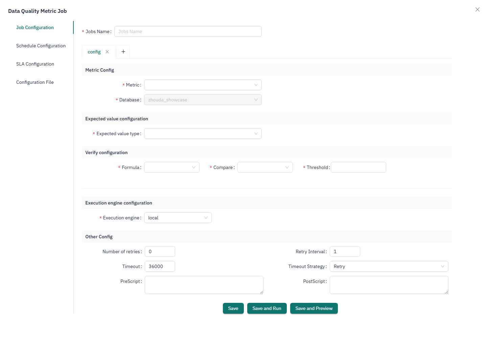

- 选择指标、数据库、表和字段，并按需设置过滤条件。
- 支持固定期望值、比较运算符和阈值。
- 通过 Actual 等公式配置结果计算方式。
- 规则可以保存后手动执行，也可以配置定时调度。

## 血缘关系

Lineage 页面使用关系图展示表之间的数据流向。以下示例维护了这些人工血缘：

```text
customers → orders → order_items
                    → daily_sales
```

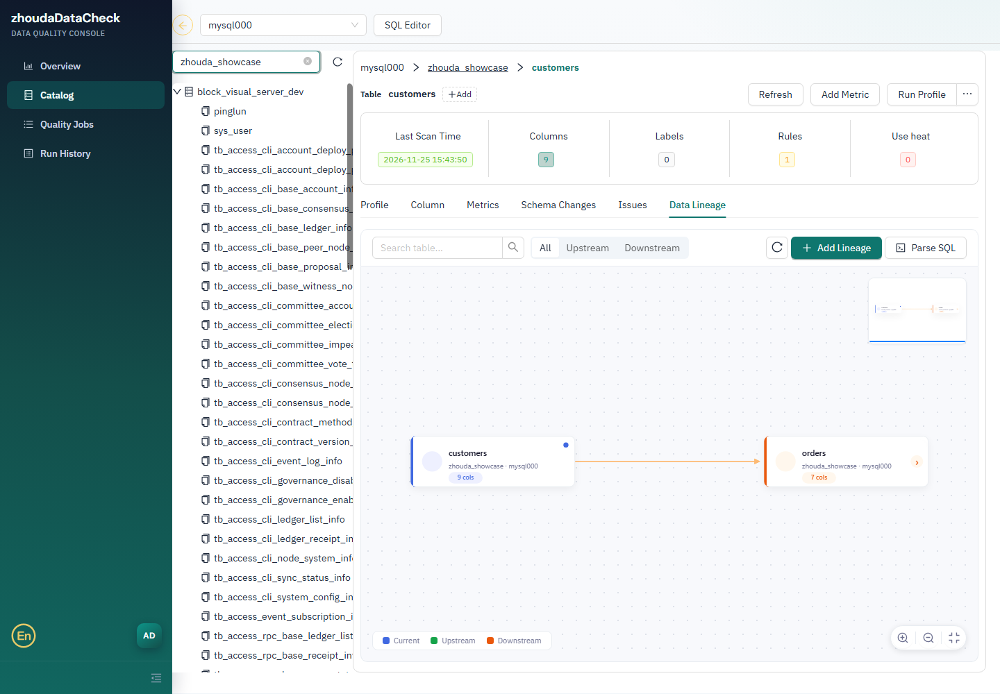

通过表级血缘可以辅助判断上游数据变化会影响哪些下游表，也为质量问题的排查和影响分析提供入口。

## 质量作业与运行历史

Quality Jobs 页面集中管理质量作业。一个作业可以包含多条指标规则，配置完成后可保存、立即运行或设置调度计划。

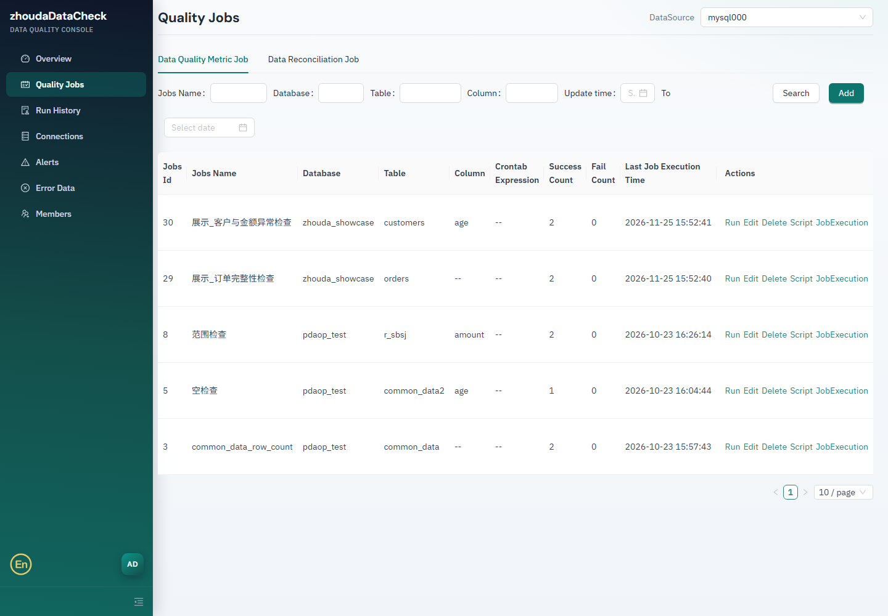

Run History 同时记录画像和质量规则的执行任务，展示任务状态、开始时间等信息，并可进入具体执行查看结果。

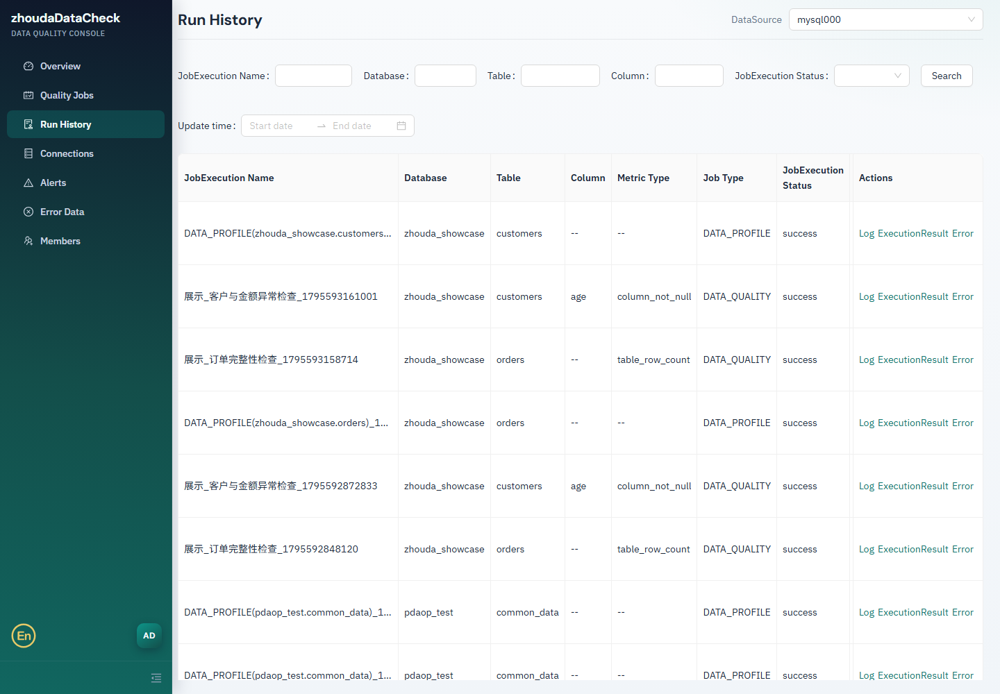

除 Web 页面外，平台支持生成作业运行脚本，并通过 `bin/zhouda-data-check-submit.sh <filePath>` 提交，便于与外部调度系统集成。

## 执行引擎

作业配置中的 Execution engine 提供 `local`、`spark`、`flink` 和 `livy` 选项。

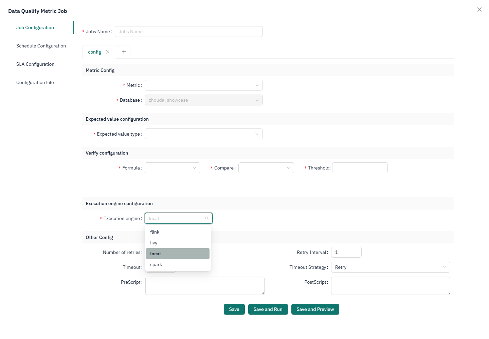

- **local**：基于 JDBC 的本地执行引擎，适合功能验证和规模较小的数据校验。
- **spark**：通过 Spark 执行分布式校验。
- **flink**：面向 Flink 运行环境的执行扩展。
- **livy**：通过 Livy 对接远程 Spark 作业。

示例作业使用 `local` 引擎完成画像和质量校验。其他引擎选项出现在配置界面中，实际运行还需要安装对应运行时、准备依赖并完成引擎参数配置。

## 架构与模块

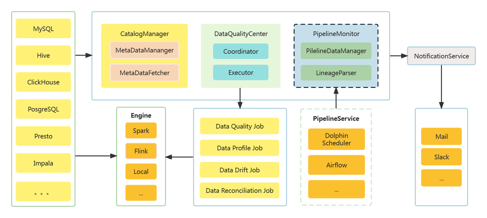

平台主要分为 Web 控制台、Server 服务、元数据存储、执行引擎和外部数据源几个部分。Server 负责任务编排、调度、状态管理和结果持久化；质量规则通过所选执行引擎下发到数据源或计算集群运行。

Quartz 使用 JDBC JobStore，元数据存储同时保存任务、连接、目录和运行结果。Server 可部署多个实例组成集群，但生产环境的高可用仍需要结合数据库、共享存储和实际部署方式验证。

## 快速开始

### 环境要求

| 组件 | 要求 |
| --- | --- |
| Java | JDK 8 |
| Maven | 3.6.1 或更高版本 |
| 元数据数据库 | 默认 MySQL；也可使用 PostgreSQL profile |
| Node.js / npm | 源码启动前端时使用，推荐 Node 16、npm 8 |
| 可选计算引擎 | Spark、Flink 或 Livy，仅在启用对应引擎时需要 |

### 1. 构建发布包

在仓库根目录执行：

```bash
mvn clean package -Prelease -DskipTests
```

构建产物位于：

```text
zhouda-data-check-dist/target/zhoudaDataCheck-1.0.0-bin.tar.gz
zhouda-data-check-dist/target/zhoudaDataCheck-1.0.0-bin.zip
```

解压后的目录包含 `bin/`、`conf/`、`libs/`、`plugins/`、`logs/`、`pid/` 和 `scripts/`。

### 2. 初始化元数据数据库

以下命令在仓库根目录执行。如果使用解压后的发布包，初始化脚本位于 `<发布包>/scripts/` 目录。

默认使用 MySQL。先创建一个空的 `zhouda_data_check` 数据库，再导入初始化脚本：

```bash
mysql -u <username> -p zhouda_data_check < scripts/zhouda-data-check-mysql.sql
```

> 初始化脚本包含建表和初始化数据，并包含 `DROP TABLE IF EXISTS`。请只在新建的空库中执行，不要导入已有业务数据的数据库。

使用 PostgreSQL 时，创建数据库并导入：

```bash
psql -U <username> -d zhouda_data_check -f scripts/zhouda-data-check-postgresql.sql
```

### 3. 配置连接并启动

编辑发布包中的 `conf/application.yaml`，把元数据数据库地址、用户名和密码替换为当前部署环境的值。默认 profile 使用 MySQL；PostgreSQL 可通过 `postgres` profile 启用。

Linux 或 macOS 启动命令：

```bash
chmod +x bin/zhouda-data-check-daemon.sh
bin/zhouda-data-check-daemon.sh start mysql
bin/zhouda-data-check-daemon.sh status
```

使用 PostgreSQL 时：

```bash
bin/zhouda-data-check-daemon.sh start postgres
```

停止服务：

```bash
bin/zhouda-data-check-daemon.sh stop
```

后端默认监听 `5600` 端口，HTTP API 前缀为 `/api/v1`。日志位于发布包的 `logs/` 目录。首次登录请使用初始化脚本创建的账号，并在登录后及时修改默认密码。

### 4. 启动 Web 控制台

发布包已包含前端静态资源。若需要从源码启动前端开发服务，可在仓库根目录的 Windows 环境执行：

```bat
bin\start-ui.cmd
```

或在 `zhouda-data-check-ui` 目录执行：

```bash
npm install
npm run dev:prod
```

开发服务默认监听 `0.0.0.0:5100`，访问：

```text
http://127.0.0.1:5100/
```

开发服务器把 `/api` 请求代理到 `http://127.0.0.1:5600/`。Windows 启动脚本也支持指定后端地址和前端端口：

```bat
zhouda-data-check-ui\start-dev.cmd http://127.0.0.1:5600/ 5100
```

局域网访问还需要确认服务器防火墙放行对应端口。

## 构建与开发

后端构建：

```bash
mvn -pl zhouda-data-check-server -am -DskipTests package
```

包含前端构建和发布包组装的全量构建：

```bash
mvn clean package -Prelease -DskipTests
```

前端本地构建：

```bash
cd zhouda-data-check-ui
npm install
npm run build:prod
```

开发服务器可通过 `DV_API_TARGET` 和 `DV_UI_PORT` 覆盖后端代理地址与监听端口：

```bash
DV_API_TARGET=http://127.0.0.1:5600/ DV_UI_PORT=5100 npm run dev:prod
```

## 作者

欢迎通过微信交流项目使用、问题反馈与合作建议。


## 贡献与许可

欢迎通过 Issue 或 Pull Request 提交问题、改进建议和代码。提交前请完成相关构建与测试，并避免提交数据库密码、访问令牌、真实业务数据等敏感信息。

本仓库遵循 [Apache License 2.0](LICENSE)。
